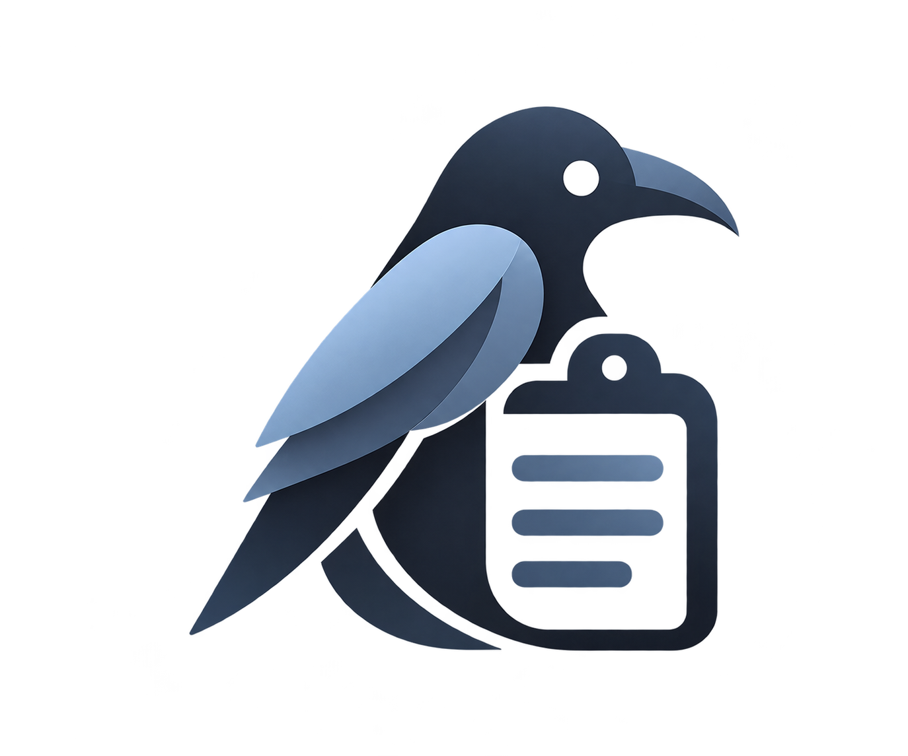

<div align="center">
<a href="https://github.com/nerdyslacker/minni"></a>
</div>
<h1 align="center">minni</h1>
<div align="center">

[](https://github.com/nerdyslacker/minni/blob/main/LICENSE)
[](https://github.com/nerdyslacker/minni/releases)
<a href="https://app.commanddash.io/agent?github=https://github.com/nerdyslacker/minni"></a>
[](https://github.com/nerdyslacker/minni/stargazers)
[](https://github.com/nerdyslacker/minni/fork)

</div>

minni is a standalone clipboard history project for Linux. The initial backend
targets X11 through XCB/XFixes.

It provides the `minnid` daemon and the `minni` CLI.

## Building

### Void Linux / LazyLinux

```sh
sudo xbps-install -S base-devel odin sqlite-devel libxcb-devel
```

Build and run the core tests:

```sh
make check
make test
make
```

## Usage

Run the daemon in your X11 session:

```sh
minnid
```

Use the CLI from another terminal:

```sh
minni capabilities
minni status
minni list --limit 20
minni search "text"
minni copy ITEM_ID
minni pin ITEM_ID
minni export ITEM_ID --output clip.png
```

`minnid` stays in the foreground for supervision. Run `minni --help` for all
history, preview, pause, clear, and watch commands.

For a standalone rofi picker, install `rofi` and `jq`, then run:

```sh
minni-rofi
```

The picker restores the selected item through Minni; rofi is not required by
the daemon or CLI.

X11 integration tests require an isolated display:

```sh
Xephyr :101 -screen 1024x768 -ac -nolisten tcp
DISPLAY=:101 make test-x11 test-ipc-x11
```
